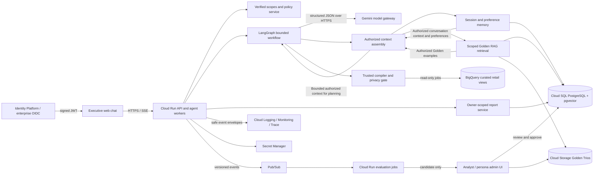
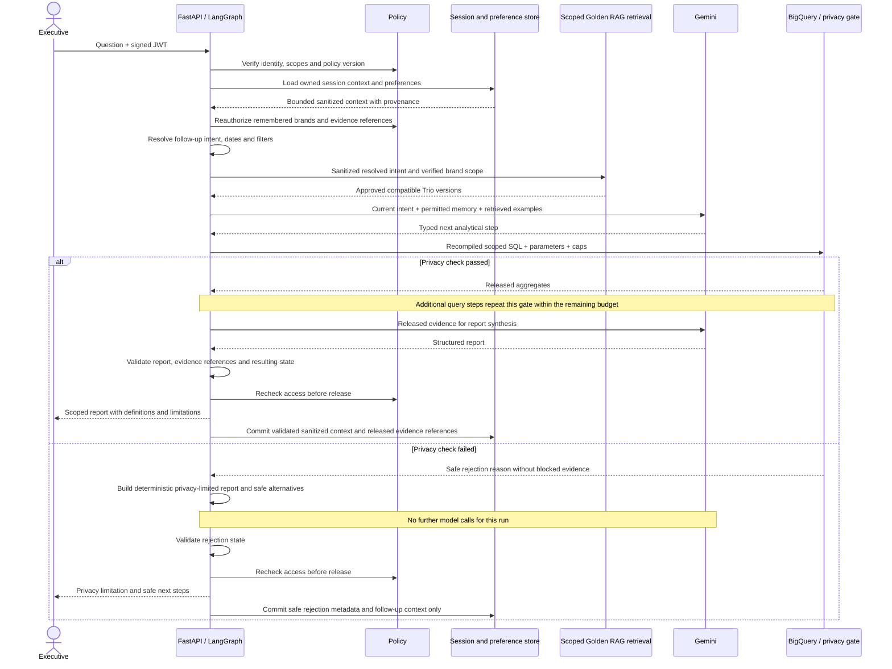
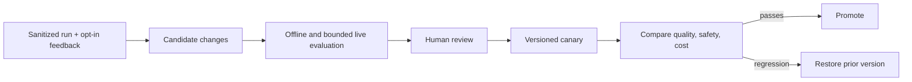

# Production high-level design

## Scope and deployment boundary

The prototype is a local Python CLI using Gemini through Google AI Studio,
BigQuery's public TheLook dataset and SQLite. This document describes the proposed
production architecture; these services are not provisioned. See the
[technical design](technical-design.md) for implemented controls and
[evaluation](evaluation.md) for validation results.

The intended users are non-technical retail executives. Brand is the only data
access dimension. A trusted issuer grants brand scopes; the CEO can analyze all
brands. Report ownership remains individual, including for the CEO. A synthetic
issuer replaces real login in the prototype. Golden Knowledge retrieval, persistent
preferences and persona management are production extensions. Automated evaluation
is separate from the application.

## Components and communication



I propose Cloud Run with FastAPI for managed request handling and scalable workers
without Kubernetes operations. An HTTPS API starts a run, returns a run ID, and
streams safe progress over SSE. A bounded worker owns each run and its deadlines.
Use Cloud Tasks for deferred work with idempotent task IDs; do not retry an entire
chargeable analysis blindly. Task and model budgets reside in PostgreSQL so a
worker restart cannot reset them. In-process LangGraph remains a small explicit
state machine, rather than granting a general autonomous agent unrestricted tools.

Cloud SQL PostgreSQL stores users' preferences, session metadata, report bodies,
confirmation snapshots, policy/persona versions and scoped knowledge indexes.
Transactions support strict deletion. `pgvector` avoids a second index service
at initial scale; move to Vertex AI Vector Search only after retrieval scale and
latency justify its additional policy synchronization complexity. Cloud Storage
stores versioned analyst-approved source artifacts. BigQuery remains the retail
analytical source. Use a separate project/service account per environment, dataset
allowlists, authorized views and row-level policies where practical. Application
scope validation remains mandatory even with warehouse controls.
In particular, a shared service account authenticates the backend, not the executive:
its IAM rights cannot by themselves enforce end-user brand scope. The privileged
gateway binds the verified user policy to every compiled request and aligns that
selection with warehouse views/policies. Do not accept a caller-provided brand
parameter as a substitute for verified entitlements.

Gemini goes through an adapter with structured output, deadlines and usage
accounting. The prototype uses **AI Studio**, authenticated by its separate API
key. A production migration to Vertex AI would be a separate adapter and compliance
decision, enabling workload identity and regional governance; it is not implemented
or assumed equivalent. Verify retention, regional processing, quotas and contractual
terms with the organization before sending production data to either service.

## 1. Hybrid intelligence: Golden Knowledge

I separate conversational memory from Golden Knowledge. Memory carries the user's
current analytical context and preferences. Golden Knowledge provides reviewed
examples of how to analyze a business question. RAG retrieves these examples before
planning; it does not replace a fresh query against BigQuery.

### Memory layers

| Layer | Contents and storage | How it is used |
|---|---|---|
| Active run | Typed LangGraph state: intent, resolved dates, filters, query steps, released evidence references and remaining budgets | Drives bounded planning and follow-up steps. Production checkpoints are stored in PostgreSQL under subject, session and run IDs. |
| Conversation memory | Bounded sanitized turns and summaries in PostgreSQL, with owner, brand scope, metric versions, provenance and expiry | Resolves follow-ups such as "compare that with September". A summary retains explicit dates and filters but is not evidence of a business result. |
| User preferences | Explicit, editable preferences in PostgreSQL, scoped to the authenticated subject | Controls presentation defaults such as detail and format. Current instructions take precedence. |
| Golden Knowledge | Reviewed question/query/report Trios in Cloud Storage; ACL metadata and embeddings in PostgreSQL with pgvector | Supplies relevant analytical methods and definitions through scoped retrieval. It is shared only within its approved access policy. |

The CLI keeps bounded conversation context in its current process. The persistent
memory layers and Golden retrieval described here extend that workflow in production.
Reports remain in the separate owner-scoped report store; saving a report does not
automatically add it to shared knowledge.

### Context assembly and execution

The production execution sequence preserves the same trust boundaries as the CLI:



On privacy rejection, the prototype stops before further model calls and provides
deterministic alternatives. The synthesis path above applies only to released data.

Context assembly follows a fixed order: verified policy and metric contracts,
current request, relevant conversation context, compatible Golden examples, then
presentation preferences. Policy remains enforced in code regardless of prompt
order. All memory and retrieved text is untrusted context, not an instruction to
invoke a tool or expand permissions. Each source has a separate token allowance;
older turns are summarized or omitted before dropping required definitions or
provenance. If the remaining context cannot resolve a reference reliably, the agent
asks for clarification instead of guessing.

For example, after an October revenue analysis for Allegra K, "compare that with
September" reuses the permitted brand, revenue definition and grouping, resolves
the September dates, and retrieves compatible comparison examples. The compiler
then builds new scoped queries. If the request changes a metric or filter, the
agent makes that change explicit rather than silently treating the results as
comparable. Retrieved reports are methodological examples, not current totals.

Before each turn, memory reads check subject ownership, current brand entitlements,
expiry and metric/schema compatibility. An earlier CEO session does not grant
all-brand access after a role change. Summaries that mix inaccessible and accessible
data are excluded as a whole. Prior numeric evidence is reusable only when its
scope, provenance, definitions and requested data freshness remain valid; otherwise
the agent queries again within its budgets. A generated summary alone never
satisfies report evidence validation.

Memory updates are committed only after validating the resulting state. Failed or
privacy-rejected runs retain safe operational metadata without storing blocked
evidence or unsupported conclusions. Safe follow-up context may include the
sanitized intent, permitted filters and rejection category, explicitly marked as
an unsuccessful analysis rather than verified findings. This lets the user request
a broader aggregation without carrying blocked data into the next turn.

Memory writes pass the same privacy checks as model input. Persist only sanitized
context and references to released evidence, never raw customer rows, suppressed
cells, credentials or hidden model reasoning. Record summary source turn IDs and
versions so stale context can be invalidated. Apply expiry and user reset to session
memory and its checkpoints; recheck report references on retrieval so a deleted
report cannot reappear through a cached body or summary. Persistent preferences are
updated only through explicit user action or confirmation, not automatically after
each conversation turn. See the consent flow in
[Continuous improvement](#4-continuous-improvement).

### Golden retrieval and publication

Each approved Trio contains `id`, `version`, sanitized question, query specification
and SQL, analyst report, metric definitions, source/schema version, effective date,
brand entitlements, owner/reviewer, validation evidence, provenance and content hash.
Store source JSON/Markdown objects in a private Cloud Storage bucket; store their
metadata, ACLs and embeddings in PostgreSQL. Do not embed identifiers or raw customer
rows. Knowledge is data, never an additional system instruction or permission grant.

At query time, verify JWT first. Extract sanitized intent and metrics, apply exact
brand/tenant ACL filters **before** vector similarity, retrieve a bounded top-k set,
then rerank on metric/date/schema compatibility. Fetch the corresponding immutable
object versions and recheck access. Prefer a small relevant set over filling context.
Record retrieved IDs, scores and versions. Revalidate the referenced metric and
recompile a new scoped query; never execute retrieved SQL directly. Fall back to
the documented metric catalog when no approved example applies, and disclose missing
knowledge rather than pretending retrieval succeeded.

An analyst creates a candidate from a sanitized successful run or uploads a Trio.
Automated schema/privacy/SQL checks and numeric regression run first. A different
authorized reviewer approves publication; indexing uses an outbox event and retries
idempotently. Publish only after source and index versions agree. Revocation updates
the ACL/tombstone first, making stale embeddings unservable; then remove embeddings
and objects according to retention policy. Monitor stale indexes, retrieval precision,
knowledge hit rate, scope denials and answer quality with/without retrieval. No
automatic promotion of user text, generated SQL or user feedback to Golden Knowledge.

## 2. Safety, scope and privacy

The frontend obtains a short-lived signed token from the trusted identity issuer.
The backend checks signature using pinned issuer keys/JWKS, allowed algorithm,
issuer, audience, expiry and not-before. Resolve brand entitlements from a trusted
policy source; do not accept brand claims selected by the user or language model.
Cache policies briefly with versioned invalidation and recheck before data release
and destructive writes. A CEO all-brands privilege does not imply report ownership.

Use least-privilege read-only BigQuery source permissions and job-creation rights
in a separate execution project. The compiler applies brand scope at order-item
grain before joins and aggregation, preventing mixed-brand order totals from leaking.
Names, emails, street addresses, postal codes and coordinates are not selected.
Demographics are aggregate-only. Suppress groups below configurable k=5 and small
churn/complement cells. Treat retrieved knowledge, product labels, user text and
tool outputs as untrusted content. Model JSON must validate against the typed
contract; authorization and SQL construction are deterministic code.

Production additionally needs centrally tracked query history and disclosure budgets
to resist differencing across repeated overlapping queries. Per-query k suppression
alone is not differential privacy. Use privacy review for customer-level spend
pseudonyms, retention and minimum cohort policy; pseudonyms are not anonymization.
Add local/entity-aware DLP for user-supplied text before the model gateway, and
test multilingual names/addresses. The prototype's text patterns are not a general
PII recognizer. These controls remain production work.

## 3. Destructive operations and reports

The model cannot invoke deletion. A deterministic command router interprets supported
report commands. Search is owner-scoped and literal. The UI previews every selected
report with ID, title, creation time and total count; large sets must be narrowed.
The server creates a short-lived single-use challenge bound to subject, permission
version, exact IDs and report content versions. The user confirms in a separate UI
action. New reports matching the original search are not added to the deletion set.

```mermaid
sequenceDiagram
    actor User
    participant API
    participant Policy
    participant DB as Report database
    User->>API: Delete reports mentioning Client X
    API->>Policy: Verify current identity and delete scope
    API->>DB: Select owned, currently accessible matches
    DB-->>API: Exact report snapshot
    API-->>User: Preview + expiring challenge
    User->>API: Explicit confirmation of this snapshot
    API->>DB: Begin transaction / lock snapshot
    API->>Policy: Revalidate subject, scopes and policy version
    API->>DB: Compare IDs, versions, ownership and expiry
    alt Every check passes
        API->>DB: Hard delete exact IDs and consume challenge atomically
        API-->>User: Deleted count
    else Changed, expired, cancelled or replayed
        API->>DB: Roll back
        API-->>User: No deletion; request a fresh preview
    end
```

No user-facing trash, undo or report recovery is offered. Audit events retain only
safe metadata, not report text. Production backup/PITR retention must be reconciled
with deletion policy: use envelope encryption and destroy report-specific keys on
deletion, propagate erasure to replicas/search indexes and test restores against an
erasure ledger. Operational backups must never resurrect a deleted report. SQLite
secure deletion in the local prototype cannot erase external filesystem snapshots.

## 4. Continuous improvement

**User level:** store explicit preferences (tables/bullets, depth, chart/text, tone)
by authenticated user, with source, confidence, updated time and consent. Offer a
visible preference editor and reset. Inferred preferences remain candidates until
the user explicitly confirms them. Keep task instructions higher priority.
Store bounded sanitized session summaries with expiry; reauthorize every retrieval.
Preference context never overrides privacy, scope or metric definitions.

**System level:** emit sanitized run outcomes and opt-in feedback to Pub/Sub. A
scheduled evaluation job builds candidate improvements to prompts, metric contracts,
retrieval and knowledge. Maintain time-separated training/development/held-out sets,
including failing and adversarial cases. Run correctness, safety, cost and UX gates;
an authorized human approves versioned rollout. Canary a small traffic fraction,
compare against baseline, and roll back on safety regression or SLO breach. There
is no unsupervised online weight update and no self-modification of executable tools.



## 5. Resilience and cost

Use independent request, model, query and total workflow deadlines. Retry only
transient transport/quota errors with bounded backoff and jitter; obey provider
retry guidance within the remaining deadline. Authentication, access, privacy and
budget failures are terminal. Repair malformed plans/query errors with safe error
categories; do not send raw provider bodies to the model. Empty data may trigger
one bounded investigation without silently broadening filters. Suppression never
triggers automatic lowering of k. Provider outages yield a clear recoverable UI
message and trace ID, not fabricated findings.

Dry-run every SQL; reject estimates over budget. Set server `maximum_bytes_billed`,
job timeout and result bounds. Reserve the full cap per accepted query, not merely
the estimate. Track input/output tokens, attempts and tool steps. Persist reservation
and idempotency state before external submission; reuse job IDs when recovering an
uncertain BigQuery acknowledgement. Cancellation is best-effort and may not prevent
all billing. Circuit breakers stop unhealthy model/data dependencies. Cached reports
are usable only after access recheck and with an explicit data-age label. No silent
cross-provider or live-to-synthetic fallback.

## 6. Quality assurance and executive UX

Use the [evaluation framework](evaluation.md): independent numeric oracles, model
planning cases, adversarial scope/PII/deletion tests, failure injection and calibrated
live scenarios. Compare churn cohorts and definitions, not only valid JSON or SQL.
Hold out phrasing, geography, periods and category combinations. Review reports for
intent coverage, numerical grounding, missing evidence, causal overclaiming and
specific actions. Treat model-as-judge as supplementary to human and deterministic
checks. An unavailable credential-dependent check blocks live acceptance.

Before release, observe executives completing best-seller, churn and quarterly-report
tasks, then save/find/cancel/delete a report. Measure completion, clarification count,
time-to-insight, accidental deletion attempts and understanding of scope/definitions.
Prototype target: no destructive operation without the exact confirmation, no hidden
truncation of the deletion preview. Accessibility review includes keyboard interaction,
screen-reader announcements and readable error messages. Production UI requirements
are proposed; the delivered interface is a terminal CLI.

## 7. Observability and operations

Propagate run/session/request IDs across API, agent, SQL jobs and report operations.
Use OpenTelemetry instrumentation and Cloud Trace; send structured allowlisted logs
to Cloud Logging. Log step type, duration, model/version, prompt-template hash,
knowledge/policy/persona versions, token counts, query fingerprint/job ID, processed
and billed bytes, cache status, repair count and categorized errors. Never log JWTs,
API keys, raw prompts, raw query results or report bodies by default.

Dashboards: completion/clarification/refusal rates; p50/p95 end-to-end and dependency
latency; cost per completed task; budget/timeout/429/5xx rates; suppression and policy
denials; repair success; retrieval quality; evidence coverage; report save/delete
outcomes. Alert on leakage sentinels and authorization bypass immediately, sustained
provider failures/budget spikes next. Initial service objectives (to validate under
load): 99.5% monthly API availability excluding explicit policy refusals; p95 simple
analysis under 60 seconds, bounded multi-step analysis under 120 seconds. Model
dependency latency may require revising these targets before committing an SLA.

Deep-dive workflow: find the trace, reconstruct ordered step metadata, inspect safe
category/status and SQL fingerprint, replay a synthetic fixture with the same
versioned contracts. Production content debugging requires explicit restricted-access
approval, DLP, short retention and audit; it is disabled by default. Keep metadata
logs 30 days initially and aggregate metrics 90 days, subject to policy approval.

## 8. Persona agility

A non-developer admin editor stores versioned persona configuration in PostgreSQL:
tone, preferred structure, verbosity and approved vocabulary. Schema validation
rejects tool permissions, authentication changes and arbitrary system instructions.
Preview against fixed sanitized examples; require reviewer approval, audit the
change, activate by version pointer and invalidate caches. Runs pin a persona
version at start. Rollback changes the pointer, without deploying code. Keep the
immutable safety policy outside this editor and higher priority than persona content.

## Scaling, recovery and extension boundary

Use regional Cloud SQL HA, automated encrypted backups, tested restores and a
proposed RPO of 15 minutes/RTO of 4 hours; validate costs and restore drills before
adopting these objectives. Cap Cloud Run concurrency, connection pools and BigQuery
jobs per user/project. Set quotas and budget alerts; alerts are not spending stops.
Use Workload Identity/service accounts and Secret Manager, no embedded key files.
Private networking, restricted egress and regional data residency require a threat
model and organizational approval before rollout.

New graph, email or web-search tools implement typed contracts with declared scopes,
data classifications, deadlines, budgets and audit events. Chart rendering consumes
only released aggregates. Email requires recipient verification, preview and explicit
send approval; search results are untrusted evidence, separately attributed from
warehouse facts. Register tools through reviewed code/config, never arbitrary model
function names. These extensions are not implemented or enabled in the prototype.
