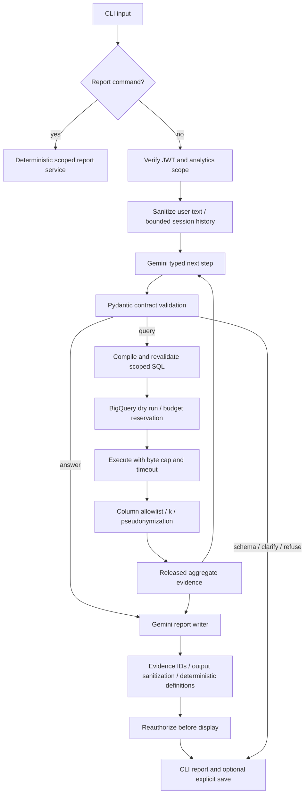

# Technical design

## Implemented architecture

The package targets Python 3.12 and 3.13. `cli.py` owns the terminal interaction;
`agent.py` owns the bounded LangGraph workflow. Pydantic contracts in `models.py`
describe analysis operations, not SQL strings. `sql.py` compiles contracts and
independently verifies them before execution. `adapters.py` integrates the real
Google SDKs, while `offline.py` executes compiled SQL against synthetic DuckDB
fixtures. `auth.py`, `privacy.py`, `budget.py` and `observability.py` enforce cross-cutting
policies. SQLite persistence and confirmation are isolated in `reports.py` and
`report_commands.py`. Dependencies are locked in `uv.lock`; CI checks a generated
pip requirements export as well.

## Identity and authorization contract

The trusted frontend/issuer supplies an RS256 JWT containing `sub`, `iss`, `aud`,
`exp`, `iat`, `nbf`, `scopes` and `brands`. The local verifier uses a configured
public key, issuer and audience; token-selected algorithms and unknown claims are
rejected. Local demo issuance is synthetic and grants no Google Cloud identity.
JWT permissions govern the application; ADC independently authenticates the
warehouse SDK. The local machine/operator and credential files are trusted.

| Scope | Capability |
|---|---|
| `analytics:read` | Plan and execute analysis within permitted brands |
| `analytics:all_brands` | CEO data access across brands, still needs analytics read |
| `reports:read` | Read own reports compatible with current brand scope |
| `reports:write` | Save own current report |
| `reports:delete` | Preview and confirm deletion of own accessible reports |

Synthetic managers use Allegra K and Levi's respectively. Tokens expire after one
hour; `auth-refresh` renews them with the existing local issuer key. Empty brand
access fails closed unless the verified all-brands scope is present. Principal
fingerprints include subject, scopes and brands. Scope changes clear session
history and invalidate deletion confirmations. Revalidation occurs at every agent
step, before final release, and inside the deletion transaction. Production issuer
rotation/revocation and managed policy synchronization are HLD requirements.

## Dynamic analysis and SQL safety

The model chooses `aggregate`, `churn` or `customers`, date windows, up to three
dimensions, metrics, parameterized filters, ordering and bounded row count. It can
perform multiple dependent queries and compare windows; this is compositional SQL,
not a catalog of hardcoded full questions. Dates are UTC `[start, end)` with at most
366 days per step. Unsupported metrics, arbitrary joins, free-form SQL, DDL/DML,
external functions, wildcards and additional source tables are unavailable.

The compiler inserts brand predicates before aggregation at the item grain. All
user/model values become typed BigQuery parameters. SQL identifiers come only from
enums and fixed mappings. Execution reconstructs the canonical request from its
immutable specification and current principal, compares SQL/parameters/output
columns/provenance, then validates a single SELECT and table allowlist with SQLGlot.
The compiler is the SQL authority. The model can only propose a typed specification.
SQL repair changes a typed specification; it never grants arbitrary SQL execution.

Supported dimensions are brand, category, product name, state, country, city, gender,
age decade, traffic source and month. Metrics include revenue, unique customers,
distinct items/orders and average order value. Arbitrary causal analysis,
forecasting and unlimited joins are not supported. Ask for clarification instead
of claiming unsupported capability. Complex questions require testing with the real
model; expressive contracts alone do not prove planning quality.
Product grouping currently uses the catalog name, so identical names are combined;
SKU-level analysis would require a separately reviewed product-ID dimension.

## Metric semantics

- **Revenue:** sum of `order_items.sale_price`, excluding Cancelled and Returned
  item statuses by default. It is a net-of-these-statuses sales proxy, not accounting
  revenue after taxes, shipping and every refund. The user may explicitly override
  the supported exclusions; the answer records them.
- **Customers/items/orders:** distinct item user, item and order IDs after scope,
  filters and time conditions. Mixed-brand orders count permitted items only.
- **Average order value:** permitted item revenue divided by distinct qualifying
  orders, not spend per customer. Ratios use safe division.
- **Churn:** the cohort has a qualifying purchase in `[start − N days, start)`;
  a member is newly inactive if its latest qualifying purchase is strictly before
  `end − N days`. N defaults to 90 and is configurable in the analysis contract.
  This is active-at-start cohort churn, not all historical customers inactive today.
- **Category contribution:** assign each cohort member to its most recent qualifying
  pre-start item, breaking timestamp ties by item ID. Each belongs to exactly one
  category; later activity in any permitted category prevents inactivity. Cohort
  filters apply after assignment. State is the user's current dataset state, not
  reconstructed historical residence. Compare both counts and denominators between
  periods; observational associations do not establish causes.

The system appends deterministic scope and per-query metric definitions to every
data-backed report, independently of the writer. Reports cite evidence IDs; those
IDs must exist. Numeric values in newly generated prose must use cell references
such as `{{q1:0:revenue}}`. `grounding.py` resolves them only against cited, released
rows and stores the metric name, value and source. The chat renderer displays
formatted values without technical annotations; `/details` retains full provenance. Unsupported literals, missing
rows/columns and uncited sources fail closed. Monetary values are rounded to two
decimals; other values retain their source representation. Derived differences,
percentages and free-form numeric targets are unsupported. Dates, filters, dimensions,
metrics and exclusions are appended deterministically from executed specifications.
This prevents rewriting numeric literals, but cannot verify every semantic assertion,
number written in words or causal claim. Human review is still necessary.

If the writer returns invalid structured output, citations or numeric prose, the
narrative is discarded. The CLI renders released query rows deterministically with
their evidence IDs and executed definitions, explicitly noting that interpretation
is unavailable. This path makes no extra model or SQL calls and rechecks access.
Privacy rejection still stops before synthesis. A `report_fallback` event records
the allowlisted validation stage and failure reason, never rejected text or result values.
Fallback monetary values use two decimal places. Interactive output keeps full
query definitions under `/details`; saved reports retain them.
Standalone English and Russian greetings are handled locally after authentication.
Successful turns retain executed query definitions alongside their summaries so
follow-ups can resolve metrics, filters and dates even after narrative fallback.
Failed turns do not append partial context. A repeated successful query reuses its
released evidence and passes through the same completeness checks before synthesis;
it is not classified as budget exhaustion. Budget errors identify the exhausted
limit in allowlisted telemetry without increasing any ceiling.

A targeted metric-interpretation check rejects AOV, average transaction value and
related order-value statements that use customer counts or lack an AOV reference
or same-row revenue/order references. Revenue per distinct customer is a separate
metric. This conservative lexical check can reject ambiguous wording; it is not a
general semantic validator. Invalid interpretation uses the same safe fallback as
invalid numeric claims. Derived numeric arithmetic remains unsupported.

Before synthesis, bounded completeness heuristics check recognized temporal comparisons,
category breakdowns, California/Texas coverage and compatible metric definitions,
filters and dimensions. Missing evidence, an empty comparison period or exhausting
query steps produces an explicit incomplete-analysis report, not a completed comparison.
These checks do not establish completeness for every possible phrasing or multi-part
question. They do not silently fetch additional data or weaken privacy.

## Privacy boundary

Source first/last names, email, street address, postal code and coordinates are
absent from projections and model context. Internal user IDs support joins/counts
only. Demographic dimensions can be released only in aggregate. Trusted SQL counts
distinct customers and computes unsafe-group count **before LIMIT**. A group under
k (default 5), or a positive churn/complement cell under k, suppresses the whole
result; no small counts or partial totals reach the model. This conservative policy
can block otherwise useful broad category analyses, as observed in live evaluation.

Top-customer spend ranks contain no demographics. The trusted adapter replaces
internal IDs with HMAC-derived session/principal-scoped labels before releasing
them, after checking population size. These labels are pseudonyms, not anonymous
identities. No reverse lookup tool is exposed. They cannot identify a person or be
used as stable cross-session customer keys.

Row release requires exact expected columns, valid privacy counters and finite
numeric values. Strings pass a local email/token/phone/address sanitizer; forbidden
field requests stop before the model. Terminal control characters are stripped.
Regex text sanitization does not detect all arbitrary names, multilingual addresses
or semantic PII in user text. The source-column boundary is stronger than that text
filter. Production entity-aware DLP and cross-query disclosure controls are proposed
in the HLD; per-query k alone cannot prevent every differencing attack.

## State and saved reports

Session memory holds the last four sanitized questions and report summaries, scoped
to the current principal. It is not persisted across CLI sessions. SQLite stores
explicitly saved structured reports, owner, conversation ID, scope snapshot, creation
time and content digest. Each run has a conversation/session ID; `delete conversation`
uses that ID rather than interpreting text through the model.

Deletion previews contain exact report IDs, titles and times; selections over 100
must be narrowed. A random challenge is stored only as a hash, with owner,
principal fingerprint, expiry and exact content/version snapshot. Confirmation must
be a separate input `DELETE <challenge>`. Under `BEGIN IMMEDIATE`, recheck JWT,
scope, ownership, expiry, current hashes/metadata and every selected record; then
hard-delete exactly those records and consume the challenge in one transaction.
Replay, scope changes and modified/deleted records fail closed. Newly matching
reports are not silently added. Cancellation deletes the challenge.

SQLite uses `secure_delete=ON`, DELETE journaling, schema version 1 and private
permissions on newly created files. No trash or recovery command exists. Deleting
clears current in-memory draft/history/evidence. This cannot erase copies in OS
snapshots, exports or backups made outside the application. The application does
not protect against a local administrator editing the database or issuer key.

## Failure handling and budgets

`AgentError` exposes fixed safe messages and categories: authentication, access,
privacy, SQL policy, configuration, budget, timeout, transient provider, invalid
query/model output, confirmation, storage and internal. Raw provider messages and
stack traces are not shown in chat or sent back to the model. Transient failures
use bounded backoff; policy/auth errors never retry. SDK automatic retries are
disabled so the shared budget controls attempts. Query submission reuses a job ID
on ambiguous transport failure and retrieves an existing conflicting job.

Invalid model/query output permits bounded correction; empty results permit bounded
replanning without automatic filter expansion. Repeated successful SQL is rejected.
Privacy suppression ends analysis with a deterministic privacy-limited report and
safe alternatives: fewer grouping dimensions, a combined total, or an explicitly
requested wider time window. It does not call the planner/writer again, expose
suppressed rows, execute alternatives, alter filters or lower k. The user must ask
for a changed analysis; that query goes through all the same policies. The CLI
catches other failures and remains usable.

Defaults: 4 query steps, 8 model attempts, 2 repairs, 2 transport retries, 120-second
turn deadline, 60-second model timeout, 30-second SQL timeout, 200 result rows,
4,096 output tokens per call and 24,000 input tokens per turn. Conservative input
reservations include schema bytes and reconcile against valid provider usage.
Reserve one full SQL cap per execution: 1 GiB/query and 4 GiB/turn by default.
These are configurable safety ceilings, not predicted charges; live samples passed
with 64 MiB caps but do not calibrate every query. Never increase a cap automatically.
Dry runs are required and server byte/job-time caps remain enforced even after a
small estimate. Client cancellation is best effort.

`live_flex.py` adds per-query human review for the controlled evaluation: writes the
exact SQL, parameters, dry-run estimate and cap, then waits for separate confirmation.
Human review time is excluded from active execution latency/deadline. The normal
`chat --allow-cloud` command authorizes a live session under configured budgets; it
does not prompt before every query.

## Observability and private debugging

Interactive CLI JSON events go to the private `.runtime/agent.jsonl` file with
per-session and per-turn correlation IDs. Standalone diagnostic runners retain
stderr telemetry. Both use the same allowlisted event schema. Events
cover start/end, model attempts/success/errors, dry runs/executions, repair, errors,
report save and deletion preview/commit. Allowlisted fields include model, safe
provider status/reason, latency, usage tokens (input/output/cache/reasoning), SQL
fingerprint/job ID, bytes estimated/processed/billed, slot time, cache hit and rows.
No prompt, raw result, SQL parameter values, report content or credential is accepted
as an arbitrary log field. A safe correlation ID links OpenTelemetry event spans.
There is no production exporter or full distributed span tree configured locally.

Diagnose failures by trace/category and safe provider status, compare contract/model
versions and replay mocked cases. Never enable HTTP body debug logs around the real
SDKs. Missing provider usage is unknown usage, not proof of zero cost. See the HLD
for production versioning, retention, dashboards and restricted content diagnostics.

## Architectural decisions and trade-offs

I chose a stack that runs locally, keeps access controls testable and supports
transactional report deletion. The default test suite requires no paid services.

### Prototype stack

I chose Python to keep Google SDK integration, validation and analytical tests
in one language. Pydantic validates model responses and environment configuration at runtime;
type hints and mypy catch a different class of errors before execution. Typer exposes
the small CLI command surface, while Rich renders readable reports without building
a web frontend. Report content is rendered as literal text rather than executable
terminal markup.

LangGraph represents the repeated plan → query → plan → report flow explicitly.
This makes dependent analysis and bounded correction easier to inspect than an
unrestricted tool-calling agent. A handwritten loop would be sufficient for a
single-query demo and would reduce dependencies. I chose the graph for explicit
multi-step execution and conversational state. Authentication, SQL policy,
deletion confirmation and budgets remain application code outside model discretion.

The source dataset is hosted in BigQuery, so I use its native client rather than
copying the data into another warehouse. Its native Python SDK exposes typed parameters, dry runs, job IDs,
timeouts and billed-byte limits directly. I use Gemini through AI Studio. AI Studio
keeps model credentials separate from ADC and requires no application deployment.
The default Flash-Lite model completed the recorded structured-output smoke after
the earlier alias returned timeouts. This is operational evidence for the default,
not a claim that it is universally the cheapest or most accurate model. The model
remains configurable and final report quality needs separate evaluation.

SQLite supplies the transactions needed to bind a confirmation to an exact report
snapshot without adding a database server to the reviewer's setup. A JSON file would
make concurrent changes and atomic deletion harder to handle. SQLGlot provides a
second structural SQL check and translates compiler output for DuckDB tests; it is
not the authorization boundary. The typed compiler owns allowed operations and
scope predicates. DuckDB tests exercise actual analytical SQL and independent numeric
oracles locally, while native BigQuery behavior remains a separate integration gate.

PyJWT with cryptography verifies RS256 signatures against the trusted local issuer
key. It avoids implementing token cryptography ourselves and permits synthetic
frontend scopes without building a login service. OpenTelemetry-compatible events
and structured JSONL preserve diagnostic metadata while keeping it out of the user
dialogue. Local JSONL is sufficient for the prototype; it is not a substitute for
production dashboards, alerting or distributed trace export.

uv provides a locked dependency environment and a generated pip requirements path
for reviewers. pytest, Hypothesis and socket blocking cover examples, generated
parameter inputs and accidental network access. Ruff, mypy, Bandit, secret scanning,
dependency audit and wheel checks address different failure classes in GitHub
Actions; no individual tool is treated as proof of correctness or security.

### Production service choices

The [HLD](hld.md) defines their interactions and operating policies. Cloud Run with
FastAPI fits an HTTP/SSE service without requiring the team to operate Kubernetes.
GKE would offer more infrastructure control but introduces operational work not
justified by the prototype. Cloud SQL PostgreSQL replaces local SQLite for concurrent
report transactions and shared preferences. Adding pgvector to the same database
keeps the initial knowledge index close to its ACL metadata; a dedicated vector
service becomes an option only when measured scale requires it.

Cloud Storage holds versioned approved Golden Trios, while PostgreSQL stores their
searchable metadata and entitlements. Pub/Sub separates feedback/ingestion from
interactive analysis; Cloud Tasks handles deferred work requiring explicit task
identity and retry control. Secret Manager and workload identity replace developer
credential files in production. Cloud Logging, Monitoring and Trace provide shared
diagnostics and alerts beyond the prototype's local event file. These services add
cost and operational dependencies that need validation before rollout;
none is needed to run the delivered CLI.

### Decision summary

| Decision | Reason | Trade-off / alternative |
|---|---|---|
| Python + Pydantic + Typer | Typed contracts, Google SDK support, small terminal interface | Runtime validation still needed; no browser UI |
| LangGraph | Explicit bounded plan/query/finish transitions and multi-step state | More dependency surface than a handwritten loop; no broad LangChain tool agent |
| Gemini AI Studio adapter | Structured output, Google SDK support and observed live operation | Rate limits/model availability vary; no silent provider fallback |
| Typed compiler over free-form SQL | Deterministic scope, column and metric boundary | New analysis operators require reviewed compiler changes |
| BigQuery parameter binding + dry run | Native dialect, read-only source and server cost cap | Dry-run estimates and billed bytes differ; LIMIT does not cap scans |
| SQLite reports | Local, transactional, no extra deployment | Single-machine trust/concurrency; production PostgreSQL proposed |
| DuckDB fixture execution | Independent numeric assertions against compiled SQL | Transpilation is not proof of native BigQuery compatibility |
| Conservative whole-result suppression | Avoid leaking suppressed cells through returned totals | Lower utility; repeated-query inference still requires production controls |
| Locked dependencies, mocked CI | Reproducibility without cloud costs | Local integration evidence remains a separate release gate |

### Why I chose LangGraph

I have previous experience with LangGraph through my work on a multi-agent
knowledge assistant at M-Files, where I worked on bounded agent orchestration,
tool integration and workflow evaluation.

My work included designing graph state and agent responsibilities, implementing
routing between specialized agents, defining typed tool contracts, managing
checkpoints and enforcing execution limits to prevent uncontrolled loops and
excessive tool calls. I also evaluated agent trajectories, including routing
correctness, tool-call validation, evidence consistency and failure handling.

For the OpsFleet prototype, I chose LangGraph because it provides explicit control
over the multi-step analytical workflow: planning, SQL execution, validation,
error recovery and report generation. The prototype uses a bounded analysis graph
with session-level memory; it does not require the multi-agent topology or persistent
checkpoints used in my previous work.

## Requirement-to-implementation matrix

| Requirement | Prototype evidence / location | Production design / limitations |
|---|---|---|
| 1. Golden Knowledge | Design only; no seeded retrieval claimed | HLD §1: format, ACL retrieval, review/update/revocation |
| 2. Safety/PII/access | `auth`, `sql`, `privacy`; scope/PII/SQL negative tests | HLD §2: identity, warehouse controls, disclosure budgets/DLP |
| 3. Destructive operations | `reports`, `report_commands`; transaction/replay/ownership tests | HLD §3: UI sequence, replicas/backups erasure |
| 4. User/system learning | Four-turn session context only | HLD §4: preferences, consent, held-out evaluation, promotion |
| 5. Resilience | `budget`, `adapters`, `agent`; failure injection | HLD §5: circuit breakers, persisted reservations |
| 6. Quality assurance | Numeric fixtures, mocked integration, evaluation protocol | HLD §6: intent rubric and executive usability study |
| 7. Observability | Safe structured events, token/SQL metrics, correlation IDs | HLD §7: managed telemetry, SLOs, private debugging |
| 8. Persona agility | Design only | HLD §8: non-developer editor, versioned approval/rollback |
| Real TheLook / four tables | BigQuery adapter, native live smoke and preflight | Local client only; no source writes |
| Real Gemini support | AI Studio SDK, JSON schema validation, live smoke | Configurable model; provider-specific error/usage handling |
| Customer/product/time/schema analysis | Typed operations, rankings, dimensions, schema response | Bounded supported analytics; no arbitrary SQL |
| Multi-step / CA vs TX churn | State graph, cohort compiler, numeric oracle | Broad live scenario privacy-blocked; full acceptance pending |
| Reports and Q1 actions for Q2 | Structured writer, explicit save, definitions/evidence | Quality rubric needed; evidence IDs alone are insufficient |
| JWT frontend assumption / CEO / brand only | Demo RS256 issuer, two managers and CEO | Synthetic mapping acceptable; no real login required |
| PII threshold and metric overrides | k config; churn days/status filters; deterministic definitions | Text patterns and cross-query privacy limitations documented |
| Cross-session memory | Reports persist; conversational memory does not | Preference/history production store described in HLD |
| Modular types / config / packaging | Pydantic Settings, protocols, strict mypy, uv + wheel | Supported Python versions tested in CI matrix |
| Unit/integration/security/regression | `tests/`, sockets disabled by default | Real-service checks separate and explicitly authorized |
| CI / secrets / security / build | GitHub Actions, Ruff, mypy, pytest, Bandit, audit, secret scan | Remote CI success must be observed, not inferred locally |
| Reproducible setup / demo / troubleshooting | README, `.env.example`, lock/export, CLI fixtures | No cloud infrastructure is deployed |
| GitHub submission / diagrams / English docs | This document, HLD, README, evaluation | Publication and final readiness recorded in evaluation |
| Cost approval and calibration | Dry-run/caps, controlled live review scripts | No automatic budget increases; no guaranteed free service |

## Local startup diagnostics

`chat --allow-cloud` validates live settings even when `.env` selects offline mode.
Startup then opens diagnostics, validates the JWT, constructs BigQuery and Gemini
clients, and opens the report store. Error messages distinguish configuration,
expired/not-yet-valid/invalid or unreadable JWTs, unavailable ADC and client/store
initialization failures without printing credentials or provider exception bodies.
No credentials are refreshed automatically. `doctor` checks configured settings
and JWT file existence; its success does not establish JWT validity or ADC readiness.

Explicit brand filters are checked against verified entitlements before SQL is
compiled, including mixed permitted/unpermitted brand lists. An out-of-scope filter
raises an authorization denial without executing a dry run or data query. The
mandatory SQL brand predicate remains in place, and execution-time recompilation
repeats the check. Privacy suppression and aggregation suggestions apply only after
authorized queries; they cannot grant access to another brand.
